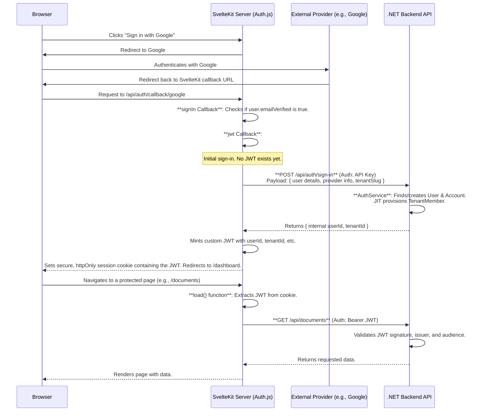
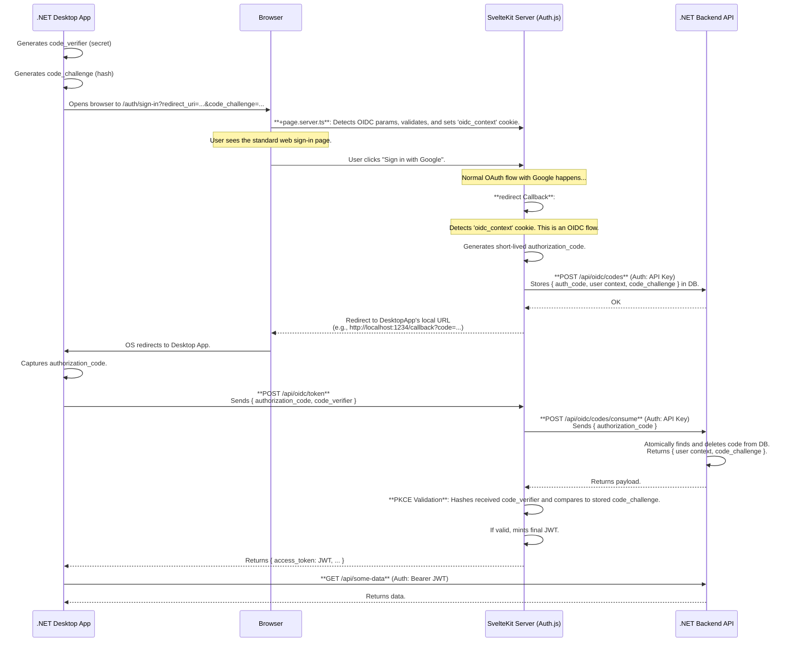

# Authentication Architecture

This document outlines the authentication architecture for the BigFatFile ecosystem, which includes the Web Application (SvelteKit) and the planned Desktop Application (.NET).

## Core Philosophy

The system is designed around a centralized authentication model where the SvelteKit web application acts as the primary **Identity Provider (IdP)** for all client applications. It handles interactions with external OAuth providers (like Google and GitHub) and mints its own custom, unified JWTs that are trusted by the .NET Backend API.

### Components

1.  **SvelteKit Frontend**: The primary web interface and the central IdP for the ecosystem. It manages user sessions via `httpOnly` cookies containing a JWT.
2.  **.NET Backend API**: The resource server. It is stateless and trusts JWTs issued by the SvelteKit IdP. It also exposes secure, server-to-server endpoints protected by a static API Key.
3.  **Desktop App**: A native client application that will use the Authorization Code Flow with PKCE to authenticate against the SvelteKit IdP.

---

## 1. Web Application Authentication Flow (OAuth)

This flow is used when a user signs into the web application via a browser.

### Step-by-Step Breakdown:

1.  **Initiation**: The user clicks a sign-in button, which triggers the Auth.js `signIn()` client-side function.
2.  **External Authentication**: Auth.js handles the complete OAuth 2.0 dance with the external provider (e.g., Google).
3.  **Callback & Validation**: The user is redirected back to the SvelteKit server. The `signIn` callback acts as a security gate, ensuring the user's email is verified by the provider.
4.  **User Provisioning**:

- The `jwt` callback is triggered for the first time.
- It makes a **server-to-server** call to the .NET API's `/api/auth/sign-in` endpoint, authenticating with a pre-shared **API Key**.
- The `AuthService` on the backend performs the "find-or-create" logic:
  - It finds or creates a `User` based on their email.
  - It finds or creates an `Account` to link the external provider to the `User`.
  - It performs Just-In-Time (JIT) provisioning by ensuring a `TenantMember` record exists, granting the user access to the current tenant.

5.  **JWT Minting**: The .NET API returns the internal `userId` and `tenantId`. The `jwt` callback uses this data to create a custom JWT, signed with the application's secret.
6.  **Session Creation**: Auth.js encrypts this JWT and stores it in a secure, `httpOnly` session cookie, then redirects the user to their dashboard.
7.  **Authenticated API Calls**: For subsequent requests, server-side `load` functions use the `fetchWithJwt` helper, which extracts the JWT from the cookie and includes it as a `Bearer` token in calls to the .NET API.

---

## 2. Desktop Application Authentication Flow (OIDC + PKCE)

This flow is planned for native clients that cannot securely store a secret, such as the .NET desktop application. It leverages the existing web sign-in UI.

### Step-by-Step Breakdown:

1.  **Initiation & PKCE**: The desktop app generates a `code_verifier` (secret) and a `code_challenge` (hash). It opens the system browser to the SvelteKit app's standard `/auth/sign-in` page, passing the `code_challenge` and its local `redirect_uri` as query parameters.
2.  **OIDC Context Detection**: The `+page.server.ts` for the sign-in page detects the OIDC parameters, validates them, and stores them in a temporary, secure `oidc_context` cookie.
3.  **Standard Sign-In**: The user authenticates using the exact same web UI as the web flow.
4.  **Authorization Code Generation**:
    - After successful external authentication, the Auth.js `redirect` callback is triggered.
    - It detects the `oidc_context` cookie, signaling an OIDC flow.
    - It generates a unique, short-lived `authorization_code`.
    - It makes a server-to-server call to the .NET API (`/api/oidc/codes`) to securely store the `authorization_code`, the user's context (from the JWT token), and the `code_challenge` in a database table (`oidc_codes`).
    - It redirects the browser to the desktop app's local callback URL, passing the `authorization_code`.
5.  **Token Exchange**:
    - The desktop app captures the `authorization_code`.
    - It makes a direct, back-channel `POST` request to the SvelteKit server's `/api/oidc/token` endpoint. This request includes the `authorization_code` and the secret `code_verifier`.
6.  **PKCE Validation & JWT Minting**:
    - The `/api/oidc/token` endpoint calls the .NET API (`/api/oidc/codes/consume`) to atomically retrieve and delete the code's context from the database. This prevents code reuse.
    - It then validates the PKCE flow by hashing the received `code_verifier` and comparing it to the `code_challenge` retrieved from the database.
    - If valid, it mints a final, standard JWT and returns it to the desktop app.
7.  **Authenticated API Calls**: The desktop app can now use this JWT as a `Bearer` token to make authenticated calls directly to the .NET Backend API.
