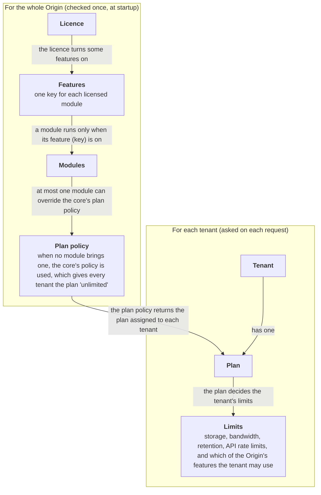
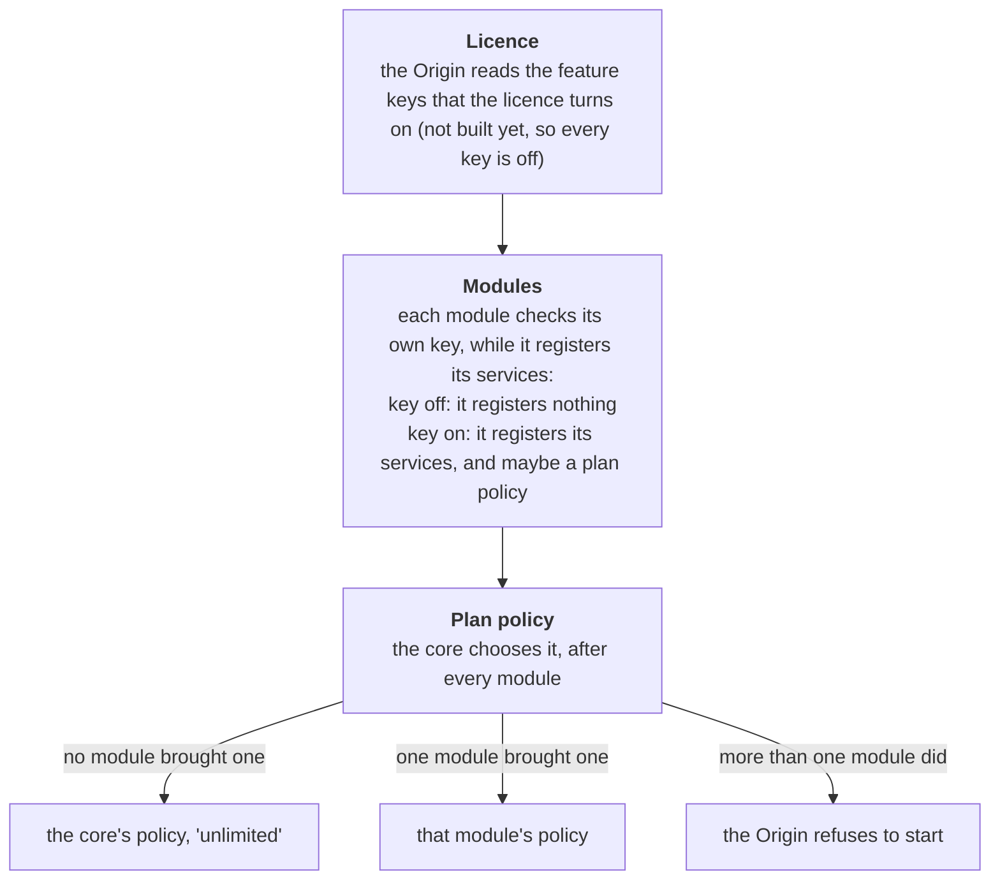
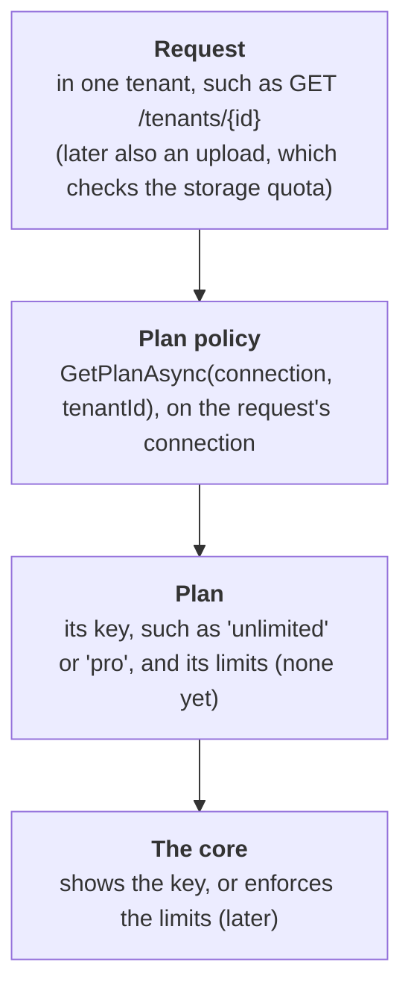

# Licensing

Which licensed features an Origin runs, and which plan each tenant has.

## 1. Features and plans

How the parts relate:

- Licensing answers two questions, with two mechanisms:
    - feature keys say which licensed code is enabled on the Origin;
    - plans say what are the limits applied for a tenant.
- Feature keys:
    - the licence turns them on;
    - they are read once, at startup;
    - they apply to the whole Origin.
- Plans:
    - the plan policy returns the selected plan for a tenant;
    - it is asked on each request;
    - its answer may change at any time, for example when a tenant changes its
      subscription.
- Where each part lives:

| Project           | Features                                                   | Plans                                                                   |
| ----------------- | ---------------------------------------------------------- | ----------------------------------------------------------------------- |
| Abstractions      | `IFeatureGate`, `FeatureKeys`, `BffModuleContext.Features` | `IPlanPolicy`, `TenantPlan`                                             |
| Origin            | `LicenceFeatureGate`, the list in `GET /api/v1/meta`       | `UnlimitedPlanPolicy`, its registration, the `plan` field of the tenant |
| A licensed module | checks its own key at startup                              | may register its own `IPlanPolicy`                                      |

## 2. Licence

- The licence is a signed document:
    - it is signed with Ed25519;
    - the Origin has the public key built in;
    - it is checked offline, so a dedicated instance without internet still starts.
- It holds:
    - the ID of the instance or the tenant that it is for;
    - the feature keys that it turns on;
    - a seat limit;
    - an expiry date;
    - a grace period.
- The Origin does not read a licence yet (M5), so every feature key is off.

## 3. Feature keys

- Each licensed module has one reserved key, such as `sso.saml` or `platform.billing`:
    - `FeatureKeys` lists them all;
    - the modules and their keys are in [Platform topology](./topology.md), section 7.
- `IFeatureGate.IsEnabled(key)` is the one check:
    - it answers for the whole Origin, and takes no tenant;
    - a key that is not reserved throws an error, so a typo fails at once instead of
      reading as "off".
- Three places use the answer:
    - modules, at startup:
        - each module checks its own key while it registers its services;
        - a module whose key is off registers nothing, so it does not exist on that
          Origin;
    - the core, which hides the UI and refuses the endpoints of a feature that is off:
        - this is not built yet;
    - the endpoints that tell clients which features are on:
        - `GET /api/v1/meta`;
        - `GET /tenants/{id}/features`, which is not built yet.
- A module checks its key only at startup, so a change to the licence takes effect at
  the next start.

## 4. Plans

- `IPlanPolicy.GetPlanAsync(connection, tenantId)` returns the tenant's `TenantPlan`.
- It runs on the request's connection:
    - a module that keeps plans in its own table reads them with the `tenant_id` being set;
    - RLS therefore applies to that read ([Authentication](../security/authentication.md), section 4).
- `TenantPlan`:
    - `Key` names the plan, such as `unlimited` (or `pro`);
    - it holds no limits yet;
    - each limit will be a new init-only property, so a module that was compiled earlier
      still loads.
- The limits that a plan will hold:
    - storage;
    - bandwidth;
    - retention;
    - API rate limits;
    - which features the tenant may use.
- Code that enforces a limit asks for the plan:
    - for example, an upload will check the storage quota;
    - the core does the check;
    - the plan only supplies the numbers.
- Today one endpoint reads the plan: `GET /tenants/{id}`, in its `plan` field.
- Which policy is used:
    - the core's policy gives every tenant the plan `unlimited`;
    - the Origin registers it after every module has registered its services, and only
      if no module has registered one;
    - only one module may register a policy:
        - when more than one does, the Origin refuses to start, and the error names
          the modules;
        - the Origin does not choose between them by the order in which the modules
          load.
- The billing module (`platform.billing`, M5) overrides the core policy:
    - when its key is on, it registers its policy, so the core's policy is no longer
      registered;
    - its policy reads the tenant's subscription, and returns that plan, such as `pro`,
      with its specific limits;
    - without the licence, it registers nothing, and every tenant falls-back to the core's
      implicit `unlimited`;
    - a self-hosted Origin therefore has no limits.

## 5. Startup

Which code runs, and which plan policy is used:

## 6. Requests

What one tenant gets:

