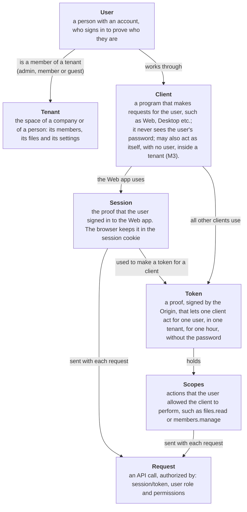
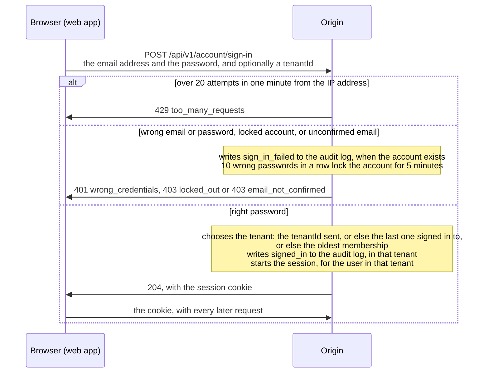
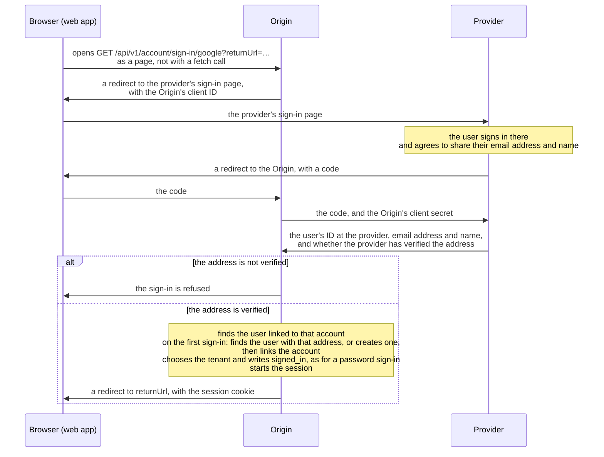
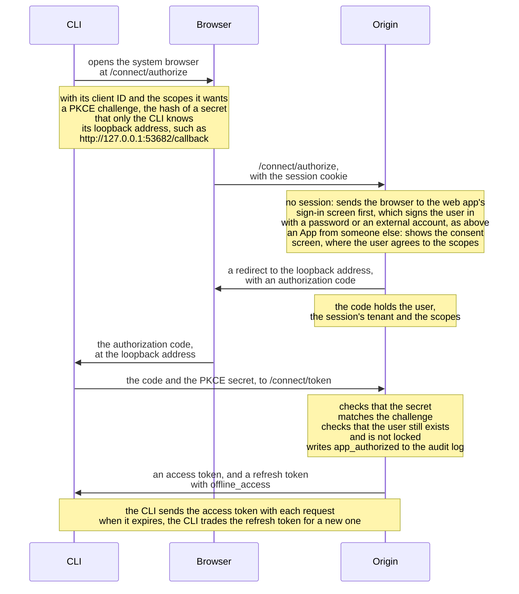
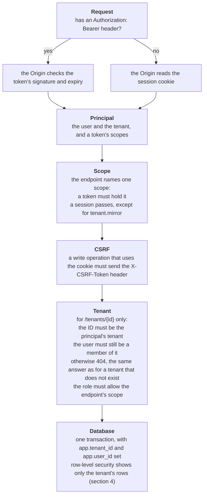

# Authentication

This document shows:

- how users and Apps sign in and prove who they act for,
- how multi-tenancy works,
- how data is kept isolated between tenants,
- and how permissions are handled inside a tenant.

## 1. Core concepts

### Who signs in, and why

- A user signs in, to prove who they are:
    - with a password;
    - or with an external account, such as Google or Microsoft;
    - only the Origin ever sees the password.
- A client acts for a signed-in user, and must prove that it's allowed.
    - the web app proves it with the session;
    - every other client proves it with a token.
- What clients do for their user:
    - the web app shows the user's files and settings in the browser;
    - the CLI uploads and downloads files from a shell;
    - the Desktop client "mounts" the tenant's files as a local folder;
    - the Replica keeps a copy of the tenant's files on-premise, which keeps working
      even without internet;
    - any 3rd-party App may do what the user allowed it, such as backing up a folder.
- An App can also act as itself, with no user, but within a tenant (M3):
    - for example, an App that imports files every night;
    - it proves who it is with its own secret, through the client-credentials flow;
    - its token holds the tenant and the scopes, and needs no user.

### Why clients use tokens

- The web app runs the Origin's own site, so the browser keeps the session in a cookie.
- Every other client runs elsewhere, such as in a shell or on another server, so it
  needs a proof of its own:
    - it must not keep the user's password (would give full access to the account);
    - a token gives much less:
        - one client;
        - one user;
        - one tenant;
        - the scopes that the user allowed;
        - for one hour;
    - when the token expires, the client trades its refresh token for a new one, without
      asking the user;
    - when the user is deleted, the next refresh fails, and the client loses access.
- The Origin signs each token:
    - nobody can change a token without the signature showing it;
    - anyone with the Origin's public key can check a token, without asking the Origin;
    - this allows the Replica to checks tokens while its internet connection is down.

### Scopes

- A scope is the name of one kind of action, written as an area, a dot and an action:
    - `files.read`: list folders and download files;
    - `files.write`: upload, rename, move and trash files;
    - `members.manage`: invite and remove members, and change their roles.
- A client lists the scopes that it wants when it asks for a token:
    - the token holds the scopes that it got, in the `scope` claim, separated by spaces;
    - today a client gets every scope that it asks for, from those it is registered with;
    - later, the user or an admin will see the list and agree to it (M3).
- Each endpoint names the one scope that it needs:
    - `GET /tenants/{id}/members` needs `members.read`;
    - `POST /tenants/{id}/invitations` needs `members.manage`;
    - `GET /tenants/{id}/audit` needs `tenant.admin`.
- A scope limits the client, not the user:
    - a token with `members.manage` still fails for a user who is not an admin;
    - the full rule is under "Rules" below.
- The list of scopes, and what each one allows, is in [API](../platform/api.md#_4-scopes).

### Token payload

What an access token holds, for example the one that the CLI App gets:

| Claim       | Example                                 | What it means                      |
| ----------- | --------------------------------------- | ---------------------------------- |
| `sub`       | `0192f0c4-…`                            | the user that it acts for          |
| `tenant_id` | `0192f0c5-…`                            | the one tenant that it works in    |
| `client_id` | `bff-dev-cli`                           | the client that holds it           |
| `scope`     | `files.read files.write offline_access` | the actions that the user allowed  |
| `exp`       | `1794013200`                            | when it stops working: in one hour |

- After the claims, the token holds the Origin's signature, made with its private key.
- A token also holds the standard claims of a JWT, such as its issuer (`iss`) and the
  time it was issued (`iat`).

### Glossary

- **claim**: one fact in a session or a token, such as `sub` (the user's ID) or
  `tenant_id` (the tenant);
- **principal**: the set of claims that the Origin reads from the cookie or the token,
  at the start of each request;
- **refresh token**: a value that a client trades for a new access token, without asking
  the user again;
- **authorization code**: a one-use value that the Origin gives a client after the user
  signs in, and that the client then trades for tokens;
- **PKCE**: a check used to protect against [code injection](https://oauth.net/2/pkce/)
  in non-web clients (e.g. CLI):
    - the client generates a secret that only it knows (the "verifier");
    - it sends the hash of the secret (the "challenge") with the authorization request;
    - it receives a code;
    - it then sends the code + the verifier in exchange for a token;
    - this way, the server uses the challenge (from the first request) and the verifier
      to ensure that only that client can finish the authorization flow;
- **CSRF token**: a value sent by the web app with each write request, to prevent
  [CSRF attacks](https://developer.mozilla.org/en-US/docs/Web/Security/Attacks/CSRF):
    - the web app reads it from `GET /api/v1/account/csrf`;
    - then attaches it to the request in the `X-CSRF-Token` header;
    - another website can't read it, so it can't make the browser send a forged write
      operation with the cookie.

### Rules

- A session and a token each work for one user, in one tenant:
    - the tenant is in the `tenant_id` claim;
    - a token gets the tenant of the session that let the client get it;
    - a refreshed token keeps its tenant and its scopes;
    - every request finds its tenant in the same place, the principal.
- A user with several tenants works in one at a time:
    - the web app switches the session's tenant by asking for a new session cookie, so
      every open tab switches with it (not built yet);
    - a client works in another tenant by getting a new token, after the user switches
      the session to that tenant.
- The role is in neither the session nor the token:
    - the Origin reads it from the membership on every request;
    - so that a change of role, or a removal from the tenant, is applied immediately.
- A request is allowed only if allowed by all of these:
    - the scope, which contains the claims that the user let the client perform:
        - a token must hold the scope that the endpoint names;
        - a session holds no scopes, and may do all that its user may do;
        - the one exception is `tenant.mirror`, which only a token can hold (it's for Apps);
    - the role, which represents what the user may do within the tenant:
        - `members.manage` and `tenant.admin` need an admin:
            - others get 403 with the error code `admin_required`;
        - `members.read` refuses a guest:
            - a guest gets 403 with the code `member_required`;
        - both rules apply with a token and with the session;
    - the permission on the folder acted upon.
- Some account endpoints work only with the session, because a token cannot start or
  end a session:
    - switching tenant;
    - accepting an invitation;
    - signing out.
- Every 30 minutes the Origin rebuilds the session from the user (the security stamp
  check):
    - a session whose user changed the password since then ends;
    - the rebuilt session keeps its tenant.

## 2. Authentication flows

### Web app sign-in using email & password

- The session cookie lasts 14 days, and is renewed while the user keeps using it.
- A user who is a member of no tenant gets a session without a tenant:
    - it can read `/api/v1/account/me`;
    - every `/tenants/{id}` endpoint answers 404.

### Web app sign-in using an external account (OAuth)

A user can sign in with an account at another service, instead of a password. The Origin
asks that service, through OAuth and OpenID Connect, who the user is.

- The providers:
    - Google;
    - Microsoft;
    - one OpenID Connect provider that the operator sets up, such as Keycloak, Authentik
      or Entra ID.
- `GET /api/v1/meta` lists the providers that this Origin has set up, in
  `account.providers`.
- The provider must have verified the email address:
    - the Origin refuses the sign-in when the provider does not say that it has;
    - without this rule, someone could create an account at a provider with another
      person's address, and then sign in to that person's account here, or accept their
      invitations.
- On the first sign-in:
    - the Origin finds the user with the same email address, or creates one when
      `BFF_SIGN_UP` allows it;
    - it links the external account to the user, and later sign-ins find the user by
      that link;
    - it adds the user to tenants from their invitations, or from a tenant's domain
      rules.

### How an App is authorized

- A refresh writes no audit row, because it only renews what the client already has.
- The refresh makes the same check:
    - a deleted user's client loses access when its access token expires;
    - a locked user's client cannot refresh until the lock ends.
- First-party clients are registered with implicit consent, so their users see no
  consent screen.
- The consent screen is not built yet, so an App from someone else is refused.

### Client flows

How each client gets its proof:

- The web app:
    - it is served by the Origin, on the same origin as the API;
    - it uses the session cookie, so the browser holds no tokens.
- The desktop client, the Replica and the CLI:
    - they get tokens through the authorization code flow with PKCE, in the system
      browser, with a loopback redirect;
    - they keep the refresh token in the platform's secure store (DPAPI, keychain,
      protected file);
    - headless installs will use the device code flow (not built yet).
- Apps:
    - an App that acts for a user gets tokens the same way as the CLI;
    - an App that acts as itself uses the client-credentials flow, as "Who signs in, and
      why" says (M3);
    - an App that acts for a user later, with both identities in the token, will use
      token exchange (RFC 8693) (M4).

### Requests

### Token types and keys

- The access token:
    - a JWT, signed with an asymmetric key (ES256) and not encrypted;
    - anyone with the public key can check it, which lets the Replica check tokens
      offline;
    - the public keys are published at the JWKS endpoint;
    - it holds the user, the App (its client ID), the tenant and the scopes;
    - it lasts one hour.
- The refresh token:
    - it is given only with the `offline_access` scope;
    - it lasts 14 days.
- The authorization code lasts 5 minutes, and works once.
- The identity token tells the client who the user is:
    - it holds the user's name only with the `profile` scope, and the email address
      only with the `email` scope;
    - the API does not accept it.
- Authorization codes and refresh tokens are read only by the Origin, so they are
  signed and also encrypted (AES).
- The lifetimes are OpenIddict's defaults, which the Origin does not change.
- Keys:
    - the signing key and the encryption key are created at first start, and kept in
      the `server_keys` table, so every node uses the same pair;
    - they are stored unencrypted, like the Data Protection keys: whoever can read the
      database can sign tokens.

### Accounts

- The Origin is the identity provider. There is no separate auth service.
- Ways to sign in:
    - an email address and a password, once the address is confirmed;
    - an external account, as "Web app sign-in using an external account" shows.
- `BFF_SIGN_UP` sets who may sign up:
    - `invitation`, the default: only invited addresses can create an account;
    - `open`: anyone can, and gets a new tenant of their own; the cloud runs this.
- `BFF_PASSWORD_SIGN_IN` turns signing in and signing up with a password on or off:
    - `true`, the default;
    - `false`: people sign in only through the external providers, and the password
      endpoints refuse: sign-in, sign-up, forgot password and reset password;
    - `GET /api/v1/meta` reports it in `account.password`;
    - the Origin refuses to start with it off and no external provider set up,
      because nobody could sign in.
- The operator is the account whose address is `BFF_OPERATOR_EMAIL`, once the address
  is confirmed:
    - the operator can open the job dashboard and create tenants;
    - that address may sign up under either policy;
    - it gets a tenant of its own, so a fresh install has its first tenant.
- Per-tenant identity providers, SAML, SCIM, group sync and LDAP are licensed modules
  behind `IAuthProvider` ([Platform topology](../platform/topology.md), section 7).

### Sign-in limits

- The account lock (`UserServices.cs`):
    - 10 wrong passwords in a row lock the account for 5 minutes;
    - during the lock, even the right password is refused;
    - during the lock, the token endpoint also refuses the user's codes and refresh
      tokens;
    - a successful sign-in sets the count back to 0;
    - the count has no time window, so wrong passwords a month apart count the same;
    - known issue: anyone who knows an address can keep its account locked, by sending
      10 wrong passwords every 5 minutes. This also stops the user's CLI and Apps from
      refreshing their tokens.
- The limit per IP address (`SignInRateLimit.cs`):
    - one address may make 20 sign-in attempts per minute, for any accounts;
    - more attempts get 429, with a `Retry-After` header;
    - all the addresses of one IPv6 /64 block count as one address;
    - each node counts on its own, so in cluster mode the limit applies per node;
    - behind a reverse proxy, the Origin sees only the proxy's address, so all clients
      share one limit.

### Two-factor sign-in

- It is not built yet.
- Password sign-in refuses an account that has it turned on, because Identity's password
  check does not ask for the second step.

### Account screens

- The account screens are pages of the web app, which every Origin image serves:
    - the screens are sign-in, sign-up, email confirmation, password reset and
      invitations;
    - the authorization endpoint sends a browser there, and the pages call the
      `/api/v1/account` endpoints ([API](../platform/api.md), section 5);
    - links in emails carry their code after `#`, which browsers never send to a server,
      so the codes stay out of request logs.

### Libraries and stores

- Libraries:
    - ASP.NET Core Identity for accounts (password hashing, email confirmation, lockout,
      two-factor, passkeys);
    - OpenIddict as the OpenID Connect server (authorization code with PKCE, device code,
      refresh tokens, client credentials, JWKS, introspection, revocation);
    - Microsoft's authentication handlers for upstream providers;
    - `Duende.IdentityModel.OidcClient` in desktop clients and the CLI;
    - MailKit for email.
- Data Protection keys (cookies, anti-forgery) are stored in the database, so that every
  node uses the same keys and the keys survive a container restart.
- Stores:
    - Identity and OpenIddict are store-based and ship EF Core implementations;
    - one small EF Core `DbContext` holds only their tables and is used at runtime by
      those two libraries; all BigFatFile tables stay on Dapper;
    - the SQL for those tables is generated once from EF and committed as ordinary
      core scripts; EF's own migrations never run;
        - the Origin's `print-auth-schema` command prints what the current packages
          expect;
        - a test selects every column the EF model maps; after a package update that
          changes the model, the test fails until a new core script matches it;
    - row-level security does not apply to these tables; users are global and tenant
      membership is ours.

## 3. Tenants

- A tenant is a company or an individual, with users, groups, drives, a warehouse and
  settings (plan, auth providers);
- One user may belong to several tenants.
- Members have a tenant role: `admin`, `member` or `guest`:
    - an administrator manages members, groups, drives and settings, and is owner of
      every drive;
    - a member may create drives and see the member list;
    - a guest has only what rules name them, and sees neither the member list nor the
      groups.
- Groups:
    - a group is a named set of members of the tenant, used as one principal in
      permission rules ("the accounting team may edit this folder");
    - administrators create groups and set their members; a member may see the groups
      they are in;
    - a group is flat: no groups inside groups, so the permission check stays one join
      and there are no cycles to detect;
    - a group that comes from a directory (`sso.groups` licensed module) is read-only in
      the web UI; the directory is its source and overwrites it on every sync;
    - deleting a group removes its rules; nothing else refers to it;
    - the tables and how a group enters the permission check are in
      [Data model](../files/data-model.md), section 4.
- Each tenant has a plan, which sets its limits ([Licensing](../platform/licensing.md), section 4).

## 4. Tenant isolation

- Application-level scoping (first layer):
    - every tenant-owned table carries `tenant_id`, used to filter all queries;
    - the `/tenants/{id}` endpoints answer 404 unless the ID is the tenant of the session
      or token and the user is still a member of it;
    - a set of isolation tests calls every endpoint with another tenant's IDs and
      expects 404s.
- Row-level security (second layer):
    - two database users:
        - requests connect as the user in `BFF_DATABASE`, which owns nothing, because
          table owners skip row-level security;
        - migrations and the job queue connect as the owner, in `BFF_DATABASE_OWNER`;
        - cross-tenant work (GC, billing, admin tasks) runs as the owner;
        - at startup the Origin creates the request user if it is missing, and grants it
          its rights;
        - the Origin refuses to start when row-level security would not apply to the
          request user;
    - each request has one transaction, which first sets two values:
        - `app.tenant_id`, the tenant of the session or token;
        - `app.user_id`, the signed-in user;
        - both are local to the transaction, so a reused connection never carries them
          into the next request;
        - nothing is saved until the handler commits;
        - the code that runs SQL never opens a connection of its own; it runs on the
          connection it is given, because a query on another connection would run
          without the tenant and the user set;
    - one policy per table, with a simple predicate:
        - `tenant_id = app_tenant_id()`;
        - `app_tenant_id()` and `app_user_id()` read the two values, and return null when
          they are not set;
        - predicates are kept simple so the planner can use the `(tenant_id, …)` indexes;
    - memberships and tenants are also visible to their user, in every tenant:
        - `/api/v1/account/me` lists the user's tenants, and sign-in chooses one of them;
        - this second policy is for reading only, so a membership changes only inside its
          own tenant.
    - partitions of a partitioned table, such as the audit log's monthly partitions:
        - policies apply only through the parent table, so a partition read directly
          would show every tenant's rows;
        - the request user has no rights on any partition, and reaches the rows only
          through the parent;
        - every start grants the request user its rights, then takes back its rights on
          every partition.

## 5. Permissions

- Rules on drives and folders grant a role (viewer, editor, owner) to a user, a group
  or the whole tenant; the nearest rule above a node decides. The tables and the check
  are in [Data model](../files/data-model.md), section 4.
- Never on a single file, a decision carried over from v1:
    - every row of a listing is visible to everyone who may open the folder, so paged
      listings are the same for every viewer and can be cached as one;
    - no per-file exception list to evaluate on every request;
    - "everyone except this person" cannot be expressed with encryption keys, so this
      keeps end-to-end encryption possible later;
    - handing one file to someone is what sends and share links do.
- External people get access through share links and guest memberships, never through
  anonymous write.
- Sends (transfers to recipients outside the system):
    - nodes under a hidden send root with:
        - an expiry;
        - a download link;
        - an optional password.
