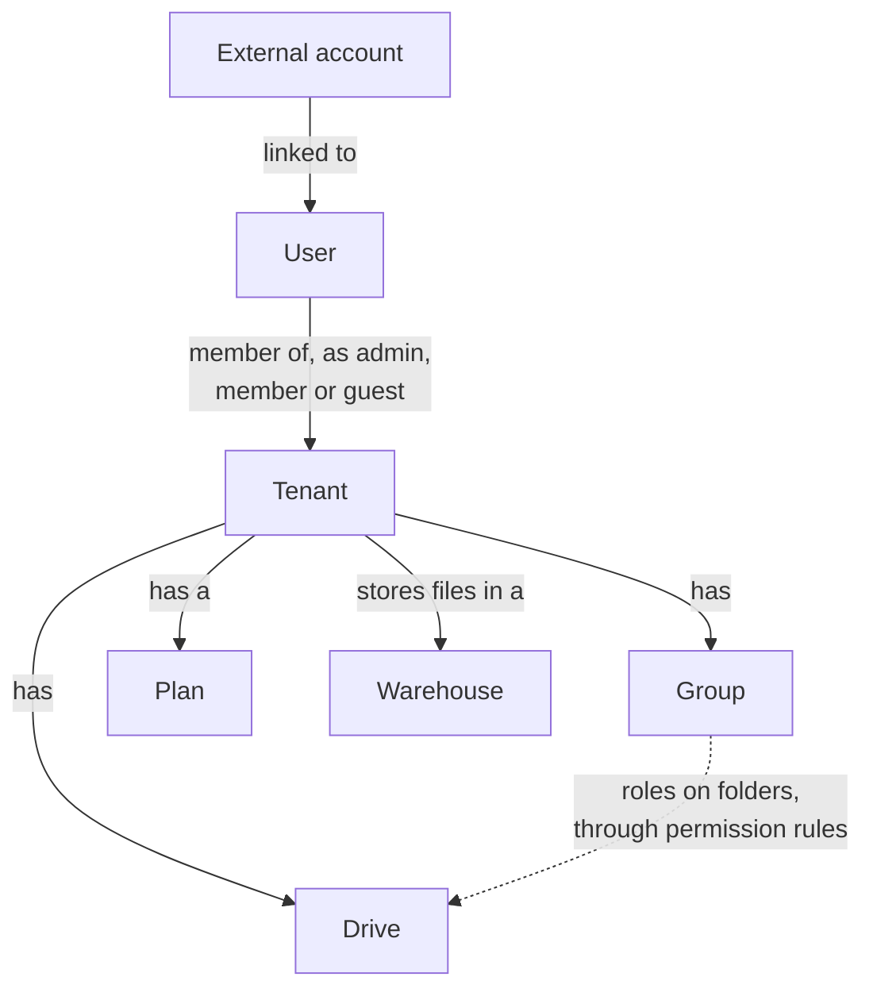

# Tenancy

This document shows:

- how users, their accounts and tenants relate,
- how a tenant is organised: roles and groups,
- how data is kept isolated between tenants,
- and how permissions are handled inside a tenant.

## 1. Core concepts

### Glossary

- **User**:
    - a person with an account, who signs in with a password or an external account;
    - belongs to no tenant, and may be a member of several.
- **External account**:
    - an account at Google, Microsoft or the operator's OpenID Connect provider;
    - linked to one user, who can then sign in with it.
- **Operator**:
    - the account set by `BFF_OPERATOR_EMAIL`, which opens the job dashboard and creates
      tenants.
- **Tenant**:
    - the space of an organization or of a person;
    - holds its members, groups, drives and settings.
- **Membership**:
    - a user's place in a tenant, with one role: `admin`, `member` or `guest`.
- **Group**:
    - a named set of members of one tenant, used as one principal in permission rules.
- **Drive**:
    - a tree of folders and files, which belongs to one tenant.
- **Permission rule**:
    - gives a user, a group or the whole tenant a role on a drive or a folder: viewer,
      editor or owner.
- **Plan**:
    - sets the tenant's limits.
- **Warehouse**:
    - the storage target that holds the tenant's files
      ([File storage](../files/storage.md)).

## 2. Accounts

- A user's account belongs to no tenant:
    - one user may be a member of several tenants;
    - a user works in one tenant at a time
      ([Authentication (section 2)](./authentication.md#_2-sessions)).
- `BFF_SIGN_UP` sets who may sign up:
    - `invitation`, the default: only invited addresses can create an account;
    - `open`: anyone can, and gets a new tenant of their own; the cloud runs this.
- The operator is the account whose address is `BFF_OPERATOR_EMAIL`, once the address
  is confirmed:
    - the operator can open the job dashboard and create tenants;
    - that address may sign up under either policy;
    - it gets a tenant of its own, so a fresh install has its first tenant.
- How users sign in is in [Authentication](./authentication.md).

## 3. Tenants

- A tenant is a company or an individual, with users, groups, drives, a warehouse and
  settings (plan, auth providers).
- Members have a tenant role: `admin`, `member` or `guest`:
    - an administrator manages members, groups, drives and settings, and is owner of
      every drive;
    - a member may create drives and see the member list;
    - a guest has only what rules name them, and sees neither the member list nor the
      groups.
- Groups:
    - a group is a named set of members of the tenant, used as one principal in
      permission rules ("the accounting team may edit this folder");
    - administrators create groups and set their members; a member may see the groups
      they are in;
    - a group is flat: no groups inside groups, so the permission check stays one join
      and there are no cycles to detect;
    - a group that comes from a directory (`sso.groups` licensed module) is read-only in
      the web UI; the directory is its source and overwrites it on every sync;
    - deleting a group removes its rules; nothing else refers to it;
    - the tables and how a group enters the permission check are in
      [Data model](../files/data-model.md), section 4.
- Each tenant has a plan, which sets its limits ([Licensing](../platform/licensing.md), section 4).

## 4. Tenant isolation

- Application-level scoping (first layer):
    - every tenant-owned table carries `tenant_id`, used to filter all queries;
    - the `/tenants/{id}` endpoints answer 404 unless the ID is the tenant of the session
      or token and the user is still a member of it;
    - a set of isolation tests calls every endpoint with another tenant's IDs and
      expects 404s.
- Row-level security (second layer):
    - two database users:
        - requests connect as the user in `BFF_DATABASE`, which owns nothing, because
          table owners skip row-level security;
        - migrations and the job queue connect as the owner, in `BFF_DATABASE_OWNER`;
        - cross-tenant work (GC, billing, admin tasks) runs as the owner;
        - at startup the Origin creates the request user if it is missing, and grants it
          its rights;
        - the Origin refuses to start when row-level security would not apply to the
          request user;
    - each request has one transaction, which first sets two values:
        - `app.tenant_id`, the tenant of the session or token;
        - `app.user_id`, the signed-in user;
        - both are local to the transaction, so a reused connection never carries them
          into the next request;
        - nothing is saved until the handler commits;
        - the code that runs SQL never opens a connection of its own; it runs on the
          connection it is given, because a query on another connection would run
          without the tenant and the user set;
    - one policy per table, with a simple predicate:
        - `tenant_id = app_tenant_id()`;
        - `app_tenant_id()` and `app_user_id()` read the two values, and return null when
          they are not set;
        - predicates are kept simple so the planner can use the `(tenant_id, …)` indexes;
    - memberships and tenants are also visible to their user, in every tenant:
        - `/api/v1/account/me` lists the user's tenants, and sign-in chooses one of them;
        - this second policy is for reading only, so a membership changes only inside its
          own tenant.
    - partitions of a partitioned table, such as the audit log's monthly partitions:
        - policies apply only through the parent table, so a partition read directly
          would show every tenant's rows;
        - the request user has no rights on any partition, and reaches the rows only
          through the parent;
        - every start grants the request user its rights, then takes back its rights on
          every partition.

## 5. Permissions

- Rules on drives and folders grant a role (viewer, editor, owner) to a user, a group
  or the whole tenant; the nearest rule above a node decides. The tables and the check
  are in [Data model](../files/data-model.md), section 4.
- Never on a single file, a decision carried over from v1:
    - every row of a listing is visible to everyone who may open the folder, so paged
      listings are the same for every viewer and can be cached as one;
    - no per-file exception list to evaluate on every request;
    - "everyone except this person" cannot be expressed with encryption keys, so this
      keeps end-to-end encryption possible later;
    - handing one file to someone is what sends and share links do.
- External people get access through share links and guest memberships, never through
  anonymous write.
- Sends (transfers to recipients outside the system):
    - nodes under a hidden send root with:
        - an expiry;
        - a download link;
        - an optional password.
